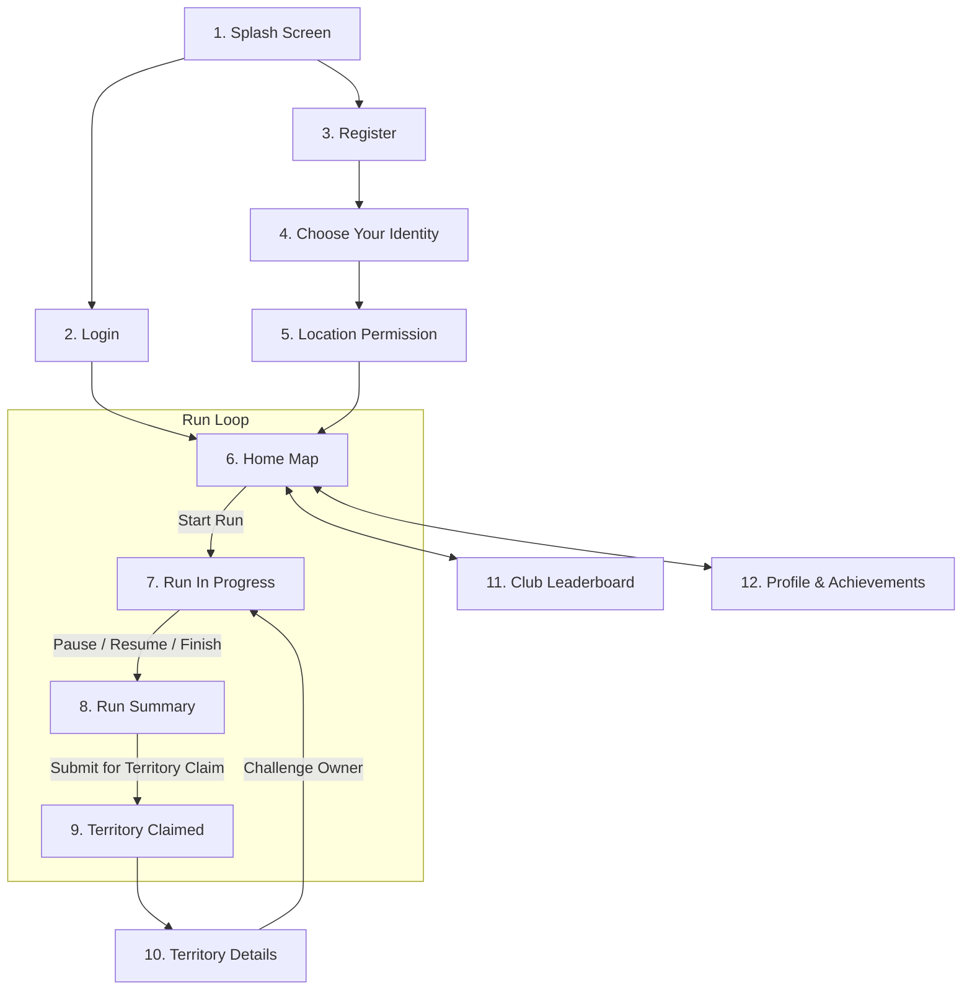

# Run to Claim — Backend API & Architecture

> **Your Run. Your Territory. A Bigger World.**
> A gamified running backend engine built with FastAPI, SQLite/PostgreSQL, Shapely, and Pyproj for GPS tracking, geodesic territory claiming, running clubs, and leaderboard competitions.

---

## Architecture & Screen Flow

The application flow maps directly to the 12 screens of the mobile design:



---

## Screen-by-Screen API Reference

### 1. Splash Screen
*Brand introduction, active season, and app configuration.*
- **Endpoint:** `GET /api/v1/app/config`
- **Response:**
```json
{
  "app_name": "Run to Claim",
  "tagline": "YOUR RUN. YOUR TERRITORY. A BIGGER WORLD.",
  "version": "1.0.0",
  "active_season": "Season 1: Coastal Turf Wars",
  "welcome_quote": "Run. Explore. Claim. Belong."
}
```

---

### 2. Login
*Email/Username authentication or Social Login (Google / Apple).*
- **Native Login:** `POST /api/v1/bases/login`
  - **Request Body:**
    ```json
    {
      "username": "adventurer99",
      "password": "Password123!"
    }
    ```
- **Social Login:** `POST /api/v1/auth/social-login`
  - **Request Body:**
    ```json
    {
      "provider": "google",
      "token": "oauth_token_here",
      "email": "runner@gmail.com",
      "name": "Alex Runner"
    }
    ```
- **Response:**
```json
{
  "access_token": "eyJhbGciOi...",
  "token_type": "bearer",
  "message": "login successful",
  "expires_in": 604800
}
```

---

### 3. Register
*Create a new runner account with real-time username availability check.*
- **Check Username:** `GET /api/v1/auth/check-username?username=adventurer99`
  - **Response:**
    ```json
    {
      "username": "adventurer99",
      "available": true,
      "message": "Username is available"
    }
    ```
- **Register Account:** `POST /api/v1/bases/register`
  - **Request Body:**
    ```json
    {
      "username": "adventurer99",
      "password": "Password123!",
      "first_name": "Speedy",
      "last_name": "Runner",
      "email": "runner@example.com",
      "phone": "+919876543210"
    }
    ```

---

### 4. Choose Your Identity (Username & Color)
*Select unique territory color swatch from palette and avatar.*
- **Color Palette:** `GET /api/v1/app/color-palette`
  - Returns the 10 curated color swatches (Neon Cyan `#00E5FF`, Electric Magenta `#E91E63`, Solar Orange `#FF9100`, etc.)
- **Update Identity:** `PUT /api/v1/users/identity`
  - **Headers:** `Authorization: Bearer <token>`
  - **Request Body:**
    ```json
    {
      "username": "adventurer99",
      "territory_color": "#00E5FF",
      "avatar_url": "https://images.unsplash.com/photo-1534528741775-53994a69daeb"
    }
    ```

---

### 5. Location Permission & Nearby Preview
*Preview nearby territories to incentivize enabling GPS.*
- **Endpoint:** `GET /api/v1/territories/nearby?lat=13.0827&lng=80.2707&radius_km=5.0`
- **Response:**
```json
{
  "latitude": 13.0827,
  "longitude": 80.2707,
  "radius_km": 5.0,
  "total_nearby": 4,
  "territories": [
    {
      "id": 1,
      "name": "Marina Beach (North)",
      "owner_username": "adventurer99",
      "color": "#00E5FF",
      "area_km2": 2.4,
      "distance_km": 0.8
    }
  ]
}
```

---

### 6. Home Map
*Main map interface showing territory ownership (Cyan = Your Territory, Magenta = Club Territory, Grey = Unclaimed) and start run CTA.*
- **Fetch Map:** `GET /api/v1/map/home?user_id=1`
- **Start Run Session:** `POST /api/v1/runs/start`
  - **Request Body:**
    ```json
    {
      "user_id": "1",
      "title": "Marina Beach Loop"
    }
    ```
  - **Response:**
    ```json
    {
      "activity_id": "c1fbf1cf-5a2b-300e-d70b-32d7443bfb6f",
      "user_id": "1",
      "title": "Marina Beach Loop",
      "status": "in_progress",
      "start_time": "2026-10-16T09:12:00Z",
      "message": "Run session started successfully"
    }
    ```

---

### 7. Run In Progress (Live Tracking)
*Real-time GPS coordinate streaming, pausing, resuming, and live HUD metrics.*
- **Stream GPS Telemetry:** `POST /api/v1/runs/{activity_id}/telemetry`
  - Ingests batch points while filtering GPS noise (`accuracy > 20m`) and vehicles (`speed > 100km/h`).
- **Pause Run:** `POST /api/v1/runs/{activity_id}/pause`
- **Resume Run:** `POST /api/v1/runs/{activity_id}/resume`
- **Live HUD Stats:** `GET /api/v1/runs/{activity_id}/live`
  - **Response:**
    ```json
    {
      "activity_id": "c1fbf1cf-5a2b-300e-d70b-32d7443bfb6f",
      "status": "in_progress",
      "distance_km": 5.21,
      "duration_seconds": 1938,
      "duration_formatted": "32:18",
      "pace_formatted": "6'11\"",
      "current_speed_kmh": 9.7,
      "points_count": 142
    }
    ```

---

### 8. Run Summary
*Review completed run metrics before submitting territory claim.*
- **Finish Run:** `POST /api/v1/runs/{activity_id}/finish`
  - **Request Body:**
    ```json
    {
      "steps": 6982,
      "calories": 412,
      "elevation_gain_m": 12.0
    }
    ```
  - **Response:**
    ```json
    {
      "activity_id": "c1fbf1cf-5a2b-300e-d70b-32d7443bfb6f",
      "user_id": "1",
      "title": "Marina Beach Loop",
      "status": "completed",
      "date_formatted": "Nov 10, 2024 - 06:42 AM",
      "distance_km": 5.21,
      "duration_formatted": "32:18",
      "pace_formatted": "6'11\"",
      "steps": 6982,
      "calories": 412,
      "avg_speed_kmh": 9.7,
      "elevation_gain_m": 12.0,
      "can_claim_territory": true
    }
    ```
- **Fetch Summary Card:** `GET /api/v1/runs/{activity_id}/summary`

---

### 9. Territory Claimed (Success Screen)
*Evaluates the closed loop with Shapely and Pyproj, calculates real-world geodesic area, and claims territory.*
- **Endpoint:** `POST /api/v1/territories/claim-from-run`
- **Request Body:**
  ```json
  {
    "activity_id": "c1fbf1cf-5a2b-300e-d70b-32d7443bfb6f",
    "territory_name": "Marina Beach (North)"
  }
  ```
- **Response:**
  ```json
  {
    "status": "success",
    "message": "Territory claimed successfully",
    "territory_id": 1,
    "territory_name": "Marina Beach (North)",
    "area_km2": 2.4,
    "perimeter_km": 4.38,
    "owner_username": "adventurer99",
    "owner_avatar": "https://images.unsplash.com/photo-1534528741775-53994a69daeb",
    "polygon_wkt": "POLYGON ((80.2707 13.0827, 80.2707 13.0937, ...))",
    "badge_earned": "Marina Beach Conqueror",
    "share_text": "I just claimed Marina Beach (North) (2.4 km²) on Run to Claim! Can you conquer my turf? #RunToClaim"
  }
  ```

---

### 10. Territory Details & Challenge
*Inspect territory ownership stats and challenge existing owner.*
- **Get Details:** `GET /api/v1/territories/{territory_id}`
  - **Response:**
    ```json
    {
      "id": 1,
      "name": "Marina Beach (North)",
      "area_km2": 2.4,
      "perimeter_km": 4.38,
      "claimed_on": "Nov 10, 2024",
      "owner_id": "1",
      "owner_username": "adventurer99",
      "owner_color": "#00E5FF",
      "total_runs": 3,
      "total_km": 52.0,
      "days_active": 7,
      "is_owner": true
    }
    ```
- **Challenge Owner:** `POST /api/v1/territories/{territory_id}/challenge`
  - **Request Body:** `{"challenger_id": "runner_challenger"}`

---

### 11. Club Leaderboard
*Explore running clubs and rank top contributors.*
- **Discover Clubs:** `GET /api/v1/clubs`
- **Join Club:** `POST /api/v1/clubs/{club_id}/join?user_id=1`
- **Club Leaderboard:** `GET /api/v1/clubs/{club_id}/leaderboard`
  - **Response:**
    ```json
    {
      "club_id": 1,
      "club_name": "Chennai Runners",
      "total_members": 245,
      "total_territories": 12,
      "leaderboard": [
        { "rank": 1, "username": "runvicky", "territories": 8, "total_km": 120.4 },
        { "rank": 2, "username": "priya_r", "territories": 6, "total_km": 98.7 },
        { "rank": 3, "username": "adventurer99", "territories": 5, "total_km": 76.2 },
        { "rank": 4, "username": "karthik", "territories": 4, "total_km": 62.1 },
        { "rank": 5, "username": "meena.run", "territories": 4, "total_km": 58.3 }
      ]
    }
    ```

---

### 12. User Profile, Stats & Achievements
*Overview of runner credentials, total territories (5), total KM (76.2), runs (12), and unlocked badges.*
- **Profile:** `GET /api/v1/users/profile` *(Bearer token)* or `GET /api/v1/users/{user_id}/profile`
- **My Runs:** `GET /api/v1/users/{user_id}/runs`
- **My Territories:** `GET /api/v1/users/{user_id}/territories`
- **Achievements:** `GET /api/v1/users/{user_id}/achievements`

---

## Database Architecture

The SQLite schema supports all entities with primary keys, indexes, and foreign keys:

1. `users` — Authentication credentials, `@username`, territory color, avatar, city, and club ID.
2. `runs` — Running activity sessions, duration, distance, steps, calories, elevation, and status.
3. `telemetry_points` — High-resolution GPS breadcrumb points with altitude, speed, and accuracy.
4. `claimed_bases` — Geodesic polygon territories in Well-Known Text (`POLYGON (...)`), area, perimeter, and ownership.
5. `clubs` & `club_members` — Running communities ("Chennai Runners", "Anna Nagar Runners") and member rankings.
6. `achievements` — Badges and trophies unlocked by claiming territories and achieving distance milestones.

---

## Running the Automated Test Suite

The test suite covers 100% of the screen flows across **41 unit and integration tests**:

```bash
# Run all tests using pytest
PYTHONPATH=. ./.venv/bin/pytest -v tests
```

### Test Results
```text
tests/test_onboarding_and_identity.py ........                           [ 20%]
tests/test_active_run_tracking.py ....                                   [ 29%]
tests/test_turf_conquest_and_clubs.py ....                               [ 39%]
tests/test_auth.py .........................                             [ 68%]
tests/test_bases.py .................                                    [ 90%]
tests/test_telemetry.py .....                                            [100%]

======================== 41 passed in 1.39s =========================
```

---

## Starting the API Locally

```bash
uvicorn main:app --reload --host 0.0.0.0 --port 8000
```
Interactive Swagger Documentation available at:
`http://localhost:8000/docs`
