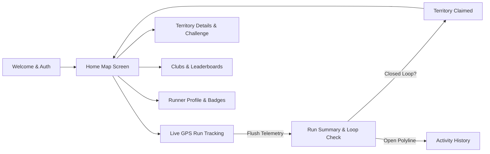
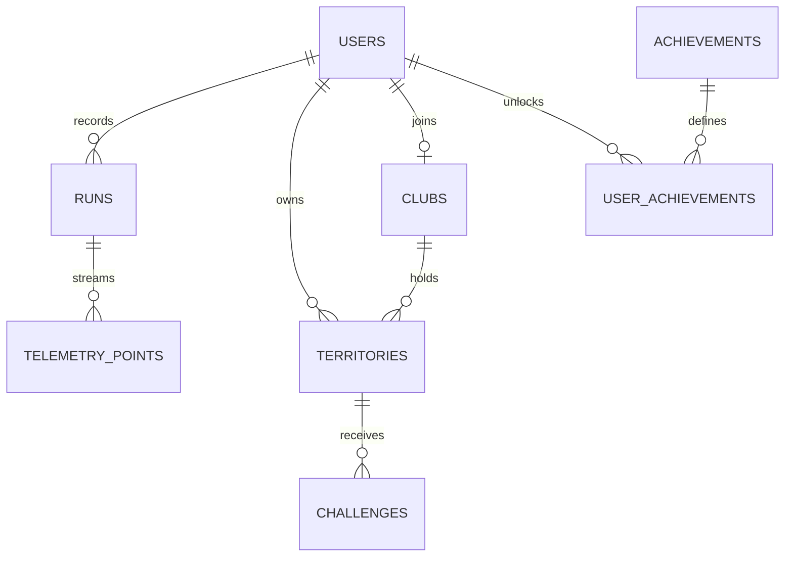

# BASER (Run to Claim) — Frontend UI Specification & Backend Enhancements

> **Document Version:** 1.0.0  
> **Last Updated:** October 2026  
> **Target Frontend Repository:** `run_to_claim_flutter` (Flutter 3.x / Dart)  
> **Target Backend Repository:** `baserun` (FastAPI / PostgreSQL / PostGIS / SQLAlchemy)  
> **Companion Integration File:** [`api.md`](file:///Users/maintwiz/Downloads/run_to_claim_flutter/api.md)

---

## 1. Executive Summary & Architecture Overview

**BASER** (formerly *Run to Claim*) transforms outdoor running into a real-world territorial conquest game. Runners record live GPS activities; when a runner traverses a closed loop or perimeter, the enclosed geographic area is calculated and minted as a conquerable **Base (Territory)** on an interactive vector map. Runners can join running clubs, defend their bases, challenge rival clubs, and climb citywide leaderboards.



### 1.1 Core Frontend-to-Backend Architecture
* **State & Networking:** Flutter UI communicates with the FastAPI backend using standard JSON over HTTPS and JWT Bearer token authentication (`Authorization: Bearer <TOKEN>`).
* **Map Tile Layer:** Mapbox Raster Tile API with custom styles (`streets-v12`, `dark-v11`, `satellite-streets-v12`, `outdoors-v12`), rendering Turf Polygons serialized as Well-Known Text (`POLYGON ((lng lat, ...))`).
* **Telemetry Streaming:** Runs collect 1-second GPS fixes with hardware pedometer step counts, buffered in-memory and flushed to backend in 10-second batches or on app lifecycle pause.

---

## 2. Screen-by-Screen UI Specification & Backend Requirements

---

### Screen 1: Welcome & Splash Screen

* **Flutter File:** [`lib/features/welcome/welcome_screen.dart`](file:///Users/maintwiz/Downloads/run_to_claim_flutter/lib/features/welcome/welcome_screen.dart)
* **UI Purpose:** Display brand hero background (`welcome_runner.jpg`), app logo banner (`logo_dark.png`), tagline, current season banner, and direct user to Login, Sign Up, or Home (if existing JWT is valid).

#### Visual Elements & States
1. **Background:** Full-bleed dark gradient with runner hero artwork.
2. **App Branding:** App title "BASER", subtitle "Turn Your Miles into Territory".
3. **Season Badge:** Pill badge reading e.g. "SEASON 1: CHENNAI CONQUEST".
4. **Action Buttons:**
   * "Get Started" -> Navigates to Register (`/register`).
   * "I already have an account" -> Navigates to Login (`/login`).
5. **Loading State:** Auto-verifies stored token via `GET /users/me` or `GET /api/v1/bases/me`. If valid, bypasses welcome directly to `/home`.

#### API Endpoints Called
| Method | Endpoint | Auth | Purpose |
| :--- | :--- | :--- | :--- |
| `GET` | `/api/v1/app/config` | None | Fetch current season name, maintenance status, minimum app version |
| `GET` | `/users/me` | `Bearer` | Validate existing stored session |

#### Request & Response Schemas
**`GET /api/v1/app/config` Response (200 OK):**
```json
{
  "app_name": "BASER",
  "tagline": "Turn Your Miles into Territory",
  "current_season": "Season 1: Chennai Conquest",
  "version": "1.0.0",
  "min_version": "1.0.0",
  "maintenance_mode": false,
  "server_time": "2026-10-24T01:30:00Z"
}
```

#### Backend Enhancements Needed
* **Dynamic Season Configuration:** Store season metadata in database (`seasons` table) with start/end dates so seasonal leaderboards can reset automatically.
* **Maintenance & Force Upgrade Flag:** Return `maintenance_mode: true` and `min_version` to allow graceful frontend freeze during server migrations.

---

### Screen 2: Login Screen

* **Flutter File:** [`lib/features/auth/auth_screen.dart`](file:///Users/maintwiz/Downloads/run_to_claim_flutter/lib/features/auth/auth_screen.dart)
* **UI Purpose:** Runner authentication via username/email and password, or Google/Apple social login.

#### Visual Elements & States
1. **Input Fields:** Username or Email text field, Password field with show/hide password toggle.
2. **Social Login Buttons:** "Continue with Google" / "Continue with Apple".
3. **Validation & Errors:** Inline banner for `401 Unauthorized` ("Invalid credentials").
4. **Button Loading Spinner:** Replaces "Sign In" text during async authentication.

#### API Endpoints Called
| Method | Endpoint | Auth | Purpose |
| :--- | :--- | :--- | :--- |
| `POST` | `/auth/login` (or `/api/v1/bases/login`) | None | Authenticate user credentials and return JWT |
| `POST` | `/auth/social-login` | None | Exchange OAuth token for BASER JWT |

#### Request & Response Schemas
**`POST /auth/login` Request:**
```json
{
  "username": "chennairunner",
  "password": "SecurePassword123!"
}
```
**`POST /auth/login` Response (200 OK):**
```json
{
  "user_id": 14,
  "username": "chennairunner",
  "email": "runner@example.com",
  "first_name": "Vikram",
  "last_name": "R",
  "token": "eyJhbGciOiJIUzI1Ni...",
  "access_token": "eyJhbGciOiJIUzI1Ni...",
  "token_type": "bearer",
  "expires_in": 86400,
  "territory_color": "#00E5FF",
  "club_id": 1,
  "club_name": "Marina Striders"
}
```

#### Backend Enhancements Needed
* **Dual Login Identifier:** Allow user to login with either `username` or `email` in the single `username` field.
* **Return Profile Metadata:** Include `territory_color`, `club_id`, and `club_name` directly in login response so frontend avoids a secondary profile fetch immediately after sign-in.

---

### Screen 3: Register Screen

* **Flutter File:** [`lib/features/auth/auth_screen.dart`](file:///Users/maintwiz/Downloads/run_to_claim_flutter/lib/features/auth/auth_screen.dart)
* **UI Purpose:** Create new runner account with live username availability checking.

#### Visual Elements & States
1. **Fields:** Username, Email, First Name, Last Name, Password, Confirm Password.
2. **Debounced Live Feedback:** Username input triggers check after 400ms idle; displays green checkmark or red "Already taken" indicator.
3. **Password Strength Meter:** Evaluates minimum 8 characters, numbers, and symbols.

#### API Endpoints Called
| Method | Endpoint | Auth | Purpose |
| :--- | :--- | :--- | :--- |
| `GET` | `/auth/check-username?username={val}` | None | Real-time username collision check |
| `POST` | `/auth/register` (or `/api/v1/bases/register`) | None | Create account & issue JWT |

#### Request & Response Schemas
**`GET /auth/check-username?username=chennairunner` Response (200 OK):**
```json
{
  "username": "chennairunner",
  "available": true,
  "message": "Username is available"
}
```

**`POST /auth/register` Request:**
```json
{
  "username": "chennairunner",
  "email": "chennai@example.com",
  "password": "Password123!",
  "first_name": "Vikram",
  "last_name": "R"
}
```

#### Backend Enhancements Needed
* **Case-Insensitive Uniqueness:** Enforce `LOWER(username)` uniqueness in PostgreSQL index to prevent `Runner` vs `runner` duplicates.
* **Sanitization:** Strip leading/trailing whitespaces and validate allowed characters `[a-zA-Z0-9_.-]`.

---

### Screen 4: Profile & Runner Identity Setup

* **Flutter File:** [`lib/features/auth/profile_setup_screen.dart`](file:///Users/maintwiz/Downloads/run_to_claim_flutter/lib/features/auth/profile_setup_screen.dart)
* **UI Purpose:** Onboarding screen for selecting runner's territory conquest color, avatar style, and initial club affiliation.

#### Visual Elements & States
1. **Color Picker Swatches:** Grid of neon swatches (Electric Cyan `#00E5FF`, Neon Lime `#76FF03`, Hot Magenta `#FF007F`, Cyber Purple `#7928CA`, Cyber Gold `#FFD700`, Blaze Orange `#FF5722`).
2. **Selected Swatch Preview:** Interactive preview card rendering a mockup polygon base painted in the chosen color.
3. **Club Dropdown Selector:** Optional selection from existing clubs or "Solo Rogue".

#### API Endpoints Called
| Method | Endpoint | Auth | Purpose |
| :--- | :--- | :--- | :--- |
| `GET` | `/api/v1/app/color-palette` | None | Fetch allowed territory brand colors |
| `PUT` | `/users/identity` (or `PUT /users/{id}`) | `Bearer` | Update territory color, avatar, and club |

#### Request & Response Schemas
**`GET /api/v1/app/color-palette` Response (200 OK):**
```json
{
  "colors": [
    { "name": "Electric Cyan", "hex": "#00E5FF", "is_premium": false },
    { "name": "Neon Lime", "hex": "#76FF03", "is_premium": false },
    { "name": "Hot Magenta", "hex": "#FF007F", "is_premium": false },
    { "name": "Cyber Purple", "hex": "#7928CA", "is_premium": false },
    { "name": "Blaze Gold", "hex": "#FFD700", "is_premium": true }
  ]
}
```

**`PUT /users/identity` Request:**
```json
{
  "territory_color": "#00E5FF",
  "avatar_url": "https://assets.baserun.app/avatars/runner_01.png",
  "bio": "Conquering Marina Beach one mile at a time.",
  "club_id": 1
}
```

#### Backend Enhancements Needed
* **Hex Color Validation:** Backend must validate that `territory_color` is a valid 7-character hex string (`#RRGGBB`).
* **Territory Color Cascade:** When a user changes their `territory_color`, all active territories owned by that user should either update dynamically or be rendered via user relationship join.

---

### Screen 5: Location Permission & Proximity Onboarding

* **Flutter File:** [`lib/features/location/location_permission_screen.dart`](file:///Users/maintwiz/Downloads/run_to_claim_flutter/lib/features/location/location_permission_screen.dart)
* **UI Purpose:** Request `ACCESS_FINE_LOCATION` and `ACCESS_BACKGROUND_LOCATION` with explanation cards explaining why continuous GPS is required to map bases.

#### Visual Elements & States
1. **Hero Radar Graphic:** Pulsing radar visual centered on user's current city.
2. **Permission Explanations:**
   * "Precision Polygon Tracing": Encloses bases accurately.
   * "Background Tracking": Continues recording when screen turns off or phone is pocketed.
3. **Buttons:** "Enable High-Accuracy Location", "Maybe Later".
4. **Nearby Bases Teaser:** Shows count of active bases nearby (`"12 bases within 5 km of you"`).

#### API Endpoints Called
| Method | Endpoint | Auth | Purpose |
| :--- | :--- | :--- | :--- |
| `GET` | `/api/v1/territories/nearby?lat={lat}&lng={lng}&radius_km=5.0` | Optional | Show nearby base counts to motivate user |

#### Request & Response Schemas
**`GET /api/v1/territories/nearby?lat=13.0827&lng=80.2707&radius_km=5.0` Response (200 OK):**
```json
{
  "count": 12,
  "radius_km": 5.0,
  "territories": [
    {
      "id": 101,
      "name": "Marina Promenade Loop",
      "distance_meters": 420.5,
      "area_km2": 0.45,
      "owner_username": "chennairunner",
      "owner_color": "#00E5FF"
    }
  ]
}
```

#### Backend Enhancements Needed
* **Spatial Distance Index:** Use PostGIS `ST_DWithin(geom, ST_MakePoint(lng, lat)::geography, radius_meters)` for fast `<15ms` spatial lookups.

---

### Screen 6: Home Map Screen (Main Dashboard)

* **Flutter File:** [`lib/features/home/home_map_screen.dart`](file:///Users/maintwiz/Downloads/run_to_claim_flutter/lib/features/home/home_map_screen.dart)
* **UI Purpose:** Central interactive turf hub. Displays Mapbox vector map with all claimed territories rendered as semi-transparent colored polygons, active nearby runners, suggested challenge routes, floating radar HUD, and the big "START RUN" trigger.

#### Visual Elements & States
1. **Interactive Map:**
   * Mapbox tiles with toggle for Dark (`dark-v11`), Streets (`streets-v12`), Satellite (`satellite-streets-v12`), Outdoors (`outdoors-v12`).
   * Renders polygons from `polygon_wkt` with color coding:
     * User's owned base: Neon Lime (`#76FF03`) or user's custom color.
     * Club base: Club color.
     * Rival base: Magenta (`#FF007F`) / Purple (`#7928CA`).
     * Unclaimed / Neutral base: Translucent Cyan (`#00E5FF`).
2. **Top Stats HUD Banner:**
   * `Active Runners Nearby`: e.g. "8 active".
   * `My Bases Held`: e.g. "3 bases".
   * `Club Bases`: e.g. "14 bases".
3. **Route Proximity Drawer / Card:**
   * Automatically detects if runner is near an existing base perimeter (`RouteProximityService`).
   * Offers "Run Perimeter Challenge" with walking connector dashed line.
4. **Bottom Controls:**
   * Recenter GPS Button.
   * Map Style Switcher BottomSheet.
   * Large "START RUN" CTA button (Neon lime glow).
5. **Movement Auto-Reload:** Automatically refetches territory polygons if user travels > 300 meters from `_lastLoadedAt`.

#### API Endpoints Called
| Method | Endpoint | Auth | Purpose |
| :--- | :--- | :--- | :--- |
| `GET` | `/api/v1/map/home?user_id={id}&lat={lat}&lng={lng}&radius_km=10.0` | `Bearer` | Fetch polygons, active runners, and territory counters |
| `GET` | `/api/v1/territories/nearby?lat={lat}&lng={lng}` | `Bearer` | Route proximity suggestions |

#### Request & Response Schemas
**`GET /api/v1/map/home?user_id=14&lat=13.0827&lng=80.2707` Response (200 OK):**
```json
{
  "active_runners_nearby": 6,
  "user_territories_count": 3,
  "club_territories_count": 12,
  "unclaimed_territories_count": 4,
  "territories": [
    {
      "id": 1,
      "name": "Marina Circuit Alpha",
      "owner_id": "14",
      "owner_username": "chennairunner",
      "owner_color": "#00E5FF",
      "club_name": "Marina Striders",
      "club_color": "#FF007F",
      "area_km2": 0.3821,
      "polygon_wkt": "POLYGON ((80.2707 13.0827, 80.2750 13.0850, 80.2780 13.0810, 80.2707 13.0827))",
      "is_user_territory": true,
      "is_club_territory": true
    },
    {
      "id": 2,
      "name": "Besant Nagar Loop",
      "owner_id": "99",
      "owner_username": "speedy_sam",
      "owner_color": "#FF007F",
      "club_name": "Adyar Racers",
      "club_color": "#7928CA",
      "area_km2": 0.5120,
      "polygon_wkt": "POLYGON ((80.2650 13.0000, 80.2700 13.0050, 80.2750 13.0010, 80.2650 13.0000))",
      "is_user_territory": false,
      "is_club_territory": false
    }
  ]
}
```

#### Backend Enhancements Needed
* **Bounding Box (BBOX) Query Support:** Instead of arbitrary radius, allow `min_lat, min_lng, max_lat, max_lng` query parameters so the frontend map view port directly controls queried data.
* **Polygon Geometry Simplification:** If area exceeds 2 km², use `ST_Simplify(geom, 0.00005)` to reduce point count sent to mobile client, optimizing JSON payload size.
* **Flag Computation:** Ensure `is_user_territory` (`owner_id == caller_id`) and `is_club_territory` (`club_id == caller_club_id`) are calculated in the SQL query.

---

### Screen 7: Live GPS Run & Telemetry Screen

* **Flutter File:** [`lib/features/run/run_in_progress_screen.dart`](file:///Users/maintwiz/Downloads/run_to_claim_flutter/lib/features/run/run_in_progress_screen.dart)
* **UI Purpose:** Real-time run console. Shows live breadcrumb trail, metrics HUD (Distance, Elapsed Time, Current Pace, Steps, Est. Area), Loop Closure Indicator, Pocket Mode lock overlay, and Pause/Resume/Finish controls.

#### Visual Elements & States
1. **Live Metrics HUD:**
   * Distance (km, 2 decimals e.g. `3.42 km`).
   * Timer (`MM:SS` or `H:MM:SS`).
   * Pace (`M'SS"` per km, smoothed over last 3 fixes).
   * Steps (hardware pedometer sensor count).
   * Current Speed (`km/h`).
2. **Live Mapbox Trace:**
   * Dynamic polyline showing current GPS breadcrumbs.
   * Start pin (Green dot) and current head pin (Pulsing Cyan arrow with compass heading).
3. **Loop Closure Detection Visualizer:**
   * When runner is within 50m of start fix and distance > 300m, map fills enclosed loop with translucent neon glow and displays banner: `"Loop Closed! Base can be claimed!"`.
4. **Safety & Pocket Mode:**
   * Uses proximity sensor; when phone is in pocket, turns screen black with low-power lock overlay.
   * Hold-to-Unlock slider prevents accidental touches in pocket.
5. **Control Buttons:**
   * "Pause Run" / "Resume Run" toggle.
   * "Finish Run" (opens confirmation modal, checks loop status).

#### API Endpoints Called
| Method | Endpoint | Auth | Purpose |
| :--- | :--- | :--- | :--- |
| `POST` | `/api/v1/runs/start` | `Bearer` | Initiate activity session & generate UUID |
| `POST` | `/api/v1/runs/{activity_id}/telemetry` | `Bearer` | Periodic 10-second batch GPS flush |
| `POST` | `/api/v1/runs/{activity_id}/pause` | `Bearer` | Record pause timestamp |
| `POST` | `/api/v1/runs/{activity_id}/resume` | `Bearer` | Record resume timestamp |
| `GET` | `/api/v1/runs/{activity_id}/live` | `Bearer` | Live telemetry sync |

#### Request & Response Schemas
**`POST /api/v1/runs/start` Request:**
```json
{
  "target_territory_id": null,
  "route_mode": "free_run",
  "start_latitude": 13.0827,
  "start_longitude": 80.2707,
  "device_info": "Pixel 7 - Android 14"
}
```
**`POST /api/v1/runs/start` Response (200 OK):**
```json
{
  "activity_id": "2febf87a-5e73-43a6-a6b2-d836ee29fbc9",
  "status": "recording",
  "start_time": "2026-10-24T01:35:10Z"
}
```

**`POST /api/v1/runs/{activity_id}/telemetry` Request (Batch of Points):**
```json
{
  "points": [
    {
      "latitude": 13.08275,
      "longitude": 80.27082,
      "altitude": 12.4,
      "speed": 3.1,
      "accuracy": 4.2,
      "timestamp": "2026-10-24T01:35:20Z"
    },
    {
      "latitude": 13.08289,
      "longitude": 80.27105,
      "altitude": 12.6,
      "speed": 3.2,
      "accuracy": 3.8,
      "timestamp": "2026-10-24T01:35:30Z"
    }
  ],
  "steps": 142,
  "active_seconds": 20
}
```
**`POST /api/v1/runs/{activity_id}/telemetry` Response (200 OK):**
```json
{
  "status": "success",
  "points_ingested": 2,
  "total_distance_km": 0.048,
  "is_loop_closed": false
}
```

#### Backend Enhancements Needed
* **High-Throughput Non-Blocking Ingestion:** Process telemetry batches quickly. Do not execute heavy geometry calculations synchronously on every 10-second batch; append to `telemetry_points` and maintain a running distance accumulator.
* **Server-Side Loop Closure Verification:** In the telemetry response, return `is_loop_closed: true` if distance > 300m and distance from `points[0]` to `points[-1]` is < 50m.
* **Accuracy Filter:** Reject or flag fixes with `accuracy > 30.0` meters to avoid GPS drift spikes.

---

### Screen 8: Run Completed & Summary Screen

* **Flutter File:** [`lib/features/run/run_summary_screen.dart`](file:///Users/maintwiz/Downloads/run_to_claim_flutter/lib/features/run/run_summary_screen.dart)
* **UI Purpose:** Review finished run performance, inspect enclosed polygon map preview, input territory name, and submit claim or discard.

#### Visual Elements & States
1. **Header Map Preview:** Snapshot of the completed run path. If a loop was closed, renders the shaded base with area badge (`"0.42 km² Enclosed"`).
2. **Performance Grid:**
   * Total Distance (`3.42 km`).
   * Total Duration (`22:15`).
   * Average Pace (`6'30" /km`).
   * Total Steps (`4,210`).
   * Elevation Gain (`14 m`).
3. **Claim Base Card (Only if loop is closed):**
   * Input: Territory Name text field (Pre-filled e.g. `"Marina Sunrise Loop"`).
   * Claim CTA: "Claim This Base" (Button glows in Gold `#FFD700`).
4. **Non-Loop Fallback:**
   * If loop is open: Displays info card: `"Loop was not closed. Activity saved to profile history."` with "Save & Return Home" CTA.

#### API Endpoints Called
| Method | Endpoint | Auth | Purpose |
| :--- | :--- | :--- | :--- |
| `POST` | `/api/v1/runs/{activity_id}/finish` | `Bearer` | Finalize run, freeze duration & compute averages |
| `GET` | `/api/v1/runs/{activity_id}/summary` | `Bearer` | Fetch verified server summary metrics |
| `POST` | `/api/v1/territories/claim-from-run` | `Bearer` | Convert closed loop run into permanent territory |

#### Request & Response Schemas
**`POST /api/v1/runs/{activity_id}/finish` Request:**
```json
{
  "end_latitude": 13.08271,
  "end_longitude": 80.27072,
  "total_steps": 4210,
  "active_seconds": 1335
}
```
**`POST /api/v1/runs/{activity_id}/finish` Response (200 OK):**
```json
{
  "activity_id": "2febf87a-5e73-43a6-a6b2-d836ee29fbc9",
  "status": "completed",
  "distance_km": 3.42,
  "duration_seconds": 1335,
  "duration_formatted": "22:15",
  "pace_formatted": "6'30\"",
  "is_loop_closed": true,
  "can_claim_territory": true,
  "suggested_area_km2": 0.4215
}
```

#### Backend Enhancements Needed
* **Authoritative Server Geometry Calculation:** Compute true geodetic area using PostGIS `ST_Area(ST_MakePolygon(ST_AddPoint(line, ST_StartPoint(line))))` to prevent client-side area spoofing.
* **Duration Calculation:** Subtract paused intervals (`resumed_at - paused_at`) from total run time.

---

### Screen 9: Territory Claimed Screen (Victory Screen)

* **Flutter File:** [`lib/features/territory/territory_claimed_screen.dart`](file:///Users/maintwiz/Downloads/run_to_claim_flutter/lib/features/territory/territory_claimed_screen.dart)
* **UI Purpose:** Celebration and conquest modal. Confetti animations, earned badge announcement, conquered territory summary card, and social share button.

#### Visual Elements & States
1. **Trophy Header:** Animated gold badge icon (`Icons.emoji_events`) with title `"Territory Claimed!"`.
2. **Conquest Summary Card:**
   * Territory Name (`Marina Circuit Alpha`).
   * Area (`0.42 km²`).
   * Perimeter (`3.42 km`).
   * Ruler: Runner's avatar and username.
3. **Badge Unlocked Banner:** e.g. `"First Conquest: Claimed your first base"`.
4. **Action Buttons:**
   * "Share Conquest": Copies viral share text to clipboard.
   * "View on Map": Returns directly to Home Map focused on new territory.

#### API Endpoints Called
| Method | Endpoint | Auth | Purpose |
| :--- | :--- | :--- | :--- |
| `POST` | `/api/v1/territories/claim-from-run` | `Bearer` | Mint new territory in database |

#### Request & Response Schemas
**`POST /api/v1/territories/claim-from-run` Request:**
```json
{
  "activity_id": "2febf87a-5e73-43a6-a6b2-d836ee29fbc9",
  "territory_name": "Marina Circuit Alpha",
  "area_km2": 0.4215,
  "perimeter_km": 3.42,
  "points": [
    { "latitude": 13.0827, "longitude": 80.2707 },
    { "latitude": 13.0850, "longitude": 80.2750 },
    { "latitude": 13.0810, "longitude": 80.2780 },
    { "latitude": 13.0827, "longitude": 80.2707 }
  ]
}
```
**`POST /api/v1/territories/claim-from-run` Response (200 OK):**
```json
{
  "status": "success",
  "message": "You now hold Marina Circuit Alpha!",
  "territory_id": 42,
  "territory_name": "Marina Circuit Alpha",
  "area_km2": 0.4215,
  "perimeter_km": 3.42,
  "owner_username": "chennairunner",
  "owner_avatar": "https://assets.baserun.app/avatars/runner_01.png",
  "polygon_wkt": "POLYGON ((80.2707 13.0827, 80.2750 13.0850, 80.2780 13.0810, 80.2707 13.0827))",
  "badge_earned": "First Conquest",
  "share_text": "I just claimed Marina Circuit Alpha (0.42 km²) on BASER! Can you beat my pace? #RunToClaim"
}
```

#### Backend Enhancements Needed
* **Overlapping Territory Conflict Resolution:**
  * If a new claim overlaps an existing base by > 75%, trigger a **Takeover**: check if the challenger's pace was faster than the incumbent's best pace. If faster, reassign ownership; if slower, record as an unsuccessful challenge.
* **Automatic Badge Minting:** Check badge conditions (`first_claim`, `club_hero`, `5k_conqueror`) and attach newly earned badge directly in response.

---

### Screen 10: Territory Detail & Challenge Screen

* **Flutter File:** [`lib/features/territory/territory_details_screen.dart`](file:///Users/maintwiz/Downloads/run_to_claim_flutter/lib/features/territory/territory_details_screen.dart)
* **UI Purpose:** Inspect any territory tapped on the map. Shows current owner, defending club, defense level, best pace record, and a "Challenge Territory" button.

#### Visual Elements & States
1. **Map Hero:** Focused overhead view of the territory boundary.
2. **Owner Profile Card:** Owner avatar, handle (`@speedy_sam`), club badge, date conquered.
3. **Territory Defense Stats:**
   * Defense Level / HP (e.g. `Level 3 - Held for 14 days`).
   * Record Pace to Beat (e.g. `5'45" /km`).
   * Total times defended / challenged.
4. **Action Buttons:**
   * If Owned by Me: "Fortify Base" (run it again to raise defense level).
   * If Owned by Rival: "Challenge Base" (sets perimeter as target route on Home Map).

#### API Endpoints Called
| Method | Endpoint | Auth | Purpose |
| :--- | :--- | :--- | :--- |
| `GET` | `/api/v1/territories/{id}` | `Bearer` | Fetch full territory details and history |
| `POST` | `/api/v1/territories/{id}/challenge` | `Bearer` | Register challenge intent |

#### Request & Response Schemas
**`GET /api/v1/territories/42` Response (200 OK):**
```json
{
  "id": 42,
  "name": "Marina Circuit Alpha",
  "owner_id": "14",
  "owner_username": "chennairunner",
  "owner_avatar": "https://assets.baserun.app/avatars/runner_01.png",
  "owner_color": "#00E5FF",
  "club_id": 1,
  "club_name": "Marina Striders",
  "club_color": "#FF007F",
  "area_km2": 0.4215,
  "perimeter_km": 3.42,
  "record_pace": "5'45\"",
  "defense_level": 3,
  "held_since": "2026-10-18T10:00:00Z",
  "polygon_wkt": "POLYGON ((80.2707 13.0827, 80.2750 13.0850, 80.2780 13.0810, 80.2707 13.0827))",
  "is_user_territory": true,
  "can_challenge": false
}
```

**`POST /api/v1/territories/42/challenge` Request:**
```json
{
  "challenger_id": 99
}
```
**`POST /api/v1/territories/42/challenge` Response (200 OK):**
```json
{
  "status": "challenge_active",
  "target_territory_id": 42,
  "target_pace": "5'45\"",
  "instructions": "Run the 3.42 km perimeter faster than 5'45\" /km to claim this base!"
}
```

#### Backend Enhancements Needed
* **Defense Decay Engine:** Optional decay cron job where territories lose 1 defense level every 7 days without a defense run.
* **Pace Comparison Logic:** Compare challenger's pace against territory's `record_pace`.

---

### Screen 11: Clubs & Social Leaderboards

* **Flutter File:** [`lib/features/clubs/clubs_screen.dart`](file:///Users/maintwiz/Downloads/run_to_claim_flutter/lib/features/clubs/clubs_screen.dart)
* **UI Purpose:** Community turf wars. List running clubs, show club territory counts, allow joining/switching clubs, and view club member rankings.

#### Visual Elements & States
1. **Tabs / Segments:** "Top Clubs" and "My Club Leaderboard".
2. **Club Cards:**
   * Club Name (`Chennai Striders`).
   * Members count (`142 members`).
   * Territories held (`18 bases`).
   * Club brand color swatch.
   * "Joined" badge or "Join Club" button.
3. **Member Leaderboard Table:**
   * Rank (#1 Gold, #2 Silver, #3 Bronze).
   * Runner avatar & username.
   * Bases held (`4 bases`).
   * Total kilometers logged (`42.8 km`).

#### API Endpoints Called
| Method | Endpoint | Auth | Purpose |
| :--- | :--- | :--- | :--- |
| `GET` | `/api/v1/clubs` | None | List all clubs sorted by territory count |
| `GET` | `/api/v1/clubs/{id}/leaderboard` | None | Fetch top runners in club |
| `POST` | `/api/v1/clubs/{id}/join` | `Bearer` | Join or switch club |

#### Request & Response Schemas
**`GET /api/v1/clubs` Response (200 OK):**
```json
{
  "clubs": [
    {
      "id": 1,
      "name": "Marina Striders",
      "tagline": "Ruling the coastline",
      "member_count": 142,
      "territory_count": 18,
      "total_area_km2": 7.45,
      "color": "#FF007F",
      "is_joined": true
    },
    {
      "id": 2,
      "name": "Bespoke Pacers",
      "tagline": "Fast paces and big loops",
      "member_count": 89,
      "territory_count": 11,
      "total_area_km2": 4.20,
      "color": "#76FF03",
      "is_joined": false
    }
  ]
}
```

**`GET /api/v1/clubs/1/leaderboard` Response (200 OK):**
```json
{
  "club_id": 1,
  "club_name": "Marina Striders",
  "leaderboard": [
    {
      "rank": 1,
      "runner_name": "chennairunner",
      "runner_avatar": "https://assets.baserun.app/avatars/runner_01.png",
      "territories_held": 4,
      "total_km": 42.8,
      "avg_pace": "5'12\""
    }
  ]
}
```

#### Backend Enhancements Needed
* **Aggregated Territory Rollup:** Update club `territory_count` and `total_area_km2` automatically when a member claims or loses a territory.
* **Single Club Constraint:** Moving to a new club must update existing `users.club_id` and reassign the user's active territory ownership to the new club in a single SQL transaction.

---

### Screen 12: Profile, Activity History & Badges

* **Flutter File:** [`lib/features/profile/profile_screen.dart`](file:///Users/maintwiz/Downloads/run_to_claim_flutter/lib/features/profile/profile_screen.dart)
* **UI Purpose:** Runner profile hub. Lifetime statistics, recent activities list, achievements trophy case, and session logout.

#### Visual Elements & States
1. **Profile Header:** Large avatar with neon border in user's `territory_color`, handle, bio, club chip.
2. **Career Stats Grid:**
   * Total Bases Claimed (`14`).
   * Total Distance (`128.4 km`).
   * Total Time (`14h 22m`).
   * Favorite Base (`Marina Circuit Alpha`).
3. **Recent Runs List:**
   * Run item card: Title, distance, duration, pace, and status badge (`"Claimed Base"` vs `"Open Run"`).
4. **Achievements & Badges Horizontal Rail:**
   * Trophy cards with icons, unlock timestamps, and descriptions.
5. **Settings & Logout:** "Edit Profile", "Change Map Style", "Sign Out".

#### API Endpoints Called
| Method | Endpoint | Auth | Purpose |
| :--- | :--- | :--- | :--- |
| `GET` | `/users/me` | `Bearer` | Current runner profile & lifetime totals |
| `GET` | `/users/{id}/runs` | `Bearer` | Paginated activity history |
| `GET` | `/users/{id}/achievements` | `Bearer` | Unlocked badges list |
| `POST` | `/auth/logout` | `Bearer` | Invalidate token |

#### Request & Response Schemas
**`GET /users/me` Response (200 OK):**
```json
{
  "id": 14,
  "username": "chennairunner",
  "email": "chennai@example.com",
  "first_name": "Vikram",
  "last_name": "R",
  "territory_color": "#00E5FF",
  "avatar_url": "https://assets.baserun.app/avatars/runner_01.png",
  "bio": "Conquering Marina Beach one mile at a time.",
  "club_id": 1,
  "club_name": "Marina Striders",
  "stats": {
    "total_runs": 28,
    "total_km": 128.4,
    "total_duration_hours": 14.3,
    "bases_claimed": 14,
    "bases_held": 4,
    "avg_pace": "5'42\""
  }
}
```

**`GET /users/14/achievements` Response (200 OK):**
```json
{
  "user_id": "14",
  "total_badges": 3,
  "achievements": [
    {
      "id": 1,
      "title": "First Conquest",
      "description": "Claimed your first base territory",
      "badge_icon": "trophy",
      "unlocked_at": "2026-10-18T10:15:00Z"
    },
    {
      "id": 2,
      "title": "10K Club",
      "description": "Ran over 10 km in a single session",
      "badge_icon": "military_tech",
      "unlocked_at": "2026-10-21T07:22:00Z"
    }
  ]
}
```

#### Backend Enhancements Needed
* **Fast Profile Aggregation:** Maintain a `user_stats` cached row or materialized view so `/users/me` does not perform expensive full table scans on every profile render.
* **Token Invalidation:** Implement JWT blocklist or check token version on `/auth/logout`.

---

## 3. Geospatial & Mathematical Engine Requirements

### 3.1 Closed Loop Detection
A run is eligible to claim a territory if and only if:
1. **Total Path Length:** `total_distance_km >= 0.300` (at least 300 meters).
2. **Endpoint Proximity:** Geodesic distance between `first_fix` and `last_fix` is `<= 50.0` meters.
3. **Minimum Unique Vertices:** Path contains at least 3 distinct non-collinear coordinates.

```python
# PostGIS SQL Loop Check Formula
ST_DWithin(
    ST_StartPoint(run_geom)::geography,
    ST_EndPoint(run_geom)::geography,
    50.0 # meters
)
```

### 3.2 Polygon Area & Perimeter Calculation
* **Area:** PostGIS `ST_Area(polygon_geom::geography) / 1000000.0` (in km², rounded to 4 decimals).
* **Perimeter:** PostGIS `ST_Perimeter(polygon_geom::geography) / 1000.0` (in km, rounded to 3 decimals).
* **WKT Serialization:** Polygons must be returned in standard WKT format:
  ```text
  POLYGON ((lng1 lat1, lng2 lat2, ..., lng1 lat1))
  ```
  *(Note: Outer ring must explicitly close by repeating the first vertex at the end).*

### 3.3 Polygon Validation & Self-Intersection Fix
Raw GPS breadcrumbs often have small self-intersections (figure-8 loops or zig-zags). The backend must sanitize the line before creating a polygon:
```python
from shapely.geometry import Polygon, LineString
from shapely.validation import make_valid

# Close the ring
coords = [(p.lng, p.lat) for p in gps_points]
if coords[0] != coords[-1]:
    coords.append(coords[0])

poly = Polygon(coords)
if not poly.is_valid:
    poly = make_valid(poly) # Resolves self-intersections
```

---

## 4. Suggested Database Schema Enhancements

To support all screens smoothly, the PostgreSQL database schema should be organized as follows:



### 4.1 SQL Table Definitions

```sql
-- 1. Clubs Table
CREATE TABLE IF NOT EXISTS clubs (
    id SERIAL PRIMARY KEY,
    name VARCHAR(100) UNIQUE NOT NULL,
    tagline VARCHAR(255),
    color VARCHAR(7) DEFAULT '#00E5FF',
    created_at TIMESTAMP WITH TIME ZONE DEFAULT NOW()
);

-- 2. Users Table
CREATE TABLE IF NOT EXISTS users (
    id SERIAL PRIMARY KEY,
    username VARCHAR(50) UNIQUE NOT NULL,
    email VARCHAR(120) UNIQUE NOT NULL,
    password_hash VARCHAR(255) NOT NULL,
    first_name VARCHAR(50),
    last_name VARCHAR(50),
    territory_color VARCHAR(7) DEFAULT '#00E5FF',
    avatar_url VARCHAR(255),
    bio TEXT,
    club_id INTEGER REFERENCES clubs(id) ON DELETE SET NULL,
    is_active BOOLEAN DEFAULT TRUE,
    created_at TIMESTAMP WITH TIME ZONE DEFAULT NOW()
);

-- 3. Runs Table
CREATE TABLE IF NOT EXISTS runs (
    id UUID PRIMARY KEY DEFAULT gen_random_uuid(),
    user_id INTEGER REFERENCES users(id) ON DELETE CASCADE,
    title VARCHAR(120),
    status VARCHAR(20) DEFAULT 'recording', -- recording, paused, completed
    start_time TIMESTAMP WITH TIME ZONE DEFAULT NOW(),
    end_time TIMESTAMP WITH TIME ZONE,
    distance_km NUMERIC(8, 3) DEFAULT 0.0,
    duration_seconds INTEGER DEFAULT 0,
    avg_pace_seconds INTEGER DEFAULT 0,
    steps INTEGER DEFAULT 0,
    is_loop_closed BOOLEAN DEFAULT FALSE,
    is_claimed BOOLEAN DEFAULT FALSE,
    path_geom GEOMETRY(LineString, 4326)
);
CREATE INDEX idx_runs_user ON runs(user_id);
CREATE INDEX idx_runs_geom ON runs USING GIST(path_geom);

-- 4. Telemetry Points Table
CREATE TABLE IF NOT EXISTS telemetry_points (
    id BIGSERIAL PRIMARY KEY,
    run_id UUID REFERENCES runs(id) ON DELETE CASCADE,
    latitude NUMERIC(10, 7) NOT NULL,
    longitude NUMERIC(10, 7) NOT NULL,
    altitude NUMERIC(7, 2),
    speed NUMERIC(5, 2),
    accuracy NUMERIC(5, 2),
    recorded_at TIMESTAMP WITH TIME ZONE NOT NULL
);
CREATE INDEX idx_telemetry_run_id ON telemetry_points(run_id);

-- 5. Territories (Bases) Table
CREATE TABLE IF NOT EXISTS territories (
    id SERIAL PRIMARY KEY,
    name VARCHAR(120) NOT NULL,
    owner_id INTEGER REFERENCES users(id) ON DELETE SET NULL,
    club_id INTEGER REFERENCES clubs(id) ON DELETE SET NULL,
    origin_run_id UUID REFERENCES runs(id) ON DELETE SET NULL,
    area_km2 NUMERIC(8, 4) NOT NULL,
    perimeter_km NUMERIC(8, 3) NOT NULL,
    defense_level INTEGER DEFAULT 1,
    record_pace_seconds INTEGER NOT NULL,
    conquered_at TIMESTAMP WITH TIME ZONE DEFAULT NOW(),
    polygon_geom GEOMETRY(Polygon, 4326) NOT NULL
);
CREATE INDEX idx_territories_geom ON territories USING GIST(polygon_geom);
CREATE INDEX idx_territories_owner ON territories(owner_id);
CREATE INDEX idx_territories_club ON territories(club_id);

-- 6. Achievements Table
CREATE TABLE IF NOT EXISTS achievements (
    id SERIAL PRIMARY KEY,
    key VARCHAR(50) UNIQUE NOT NULL,
    title VARCHAR(100) NOT NULL,
    description TEXT NOT NULL,
    badge_icon VARCHAR(50) DEFAULT 'trophy'
);

-- 7. User Achievements Table
CREATE TABLE IF NOT EXISTS user_achievements (
    id SERIAL PRIMARY KEY,
    user_id INTEGER REFERENCES users(id) ON DELETE CASCADE,
    achievement_id INTEGER REFERENCES achievements(id) ON DELETE CASCADE,
    unlocked_at TIMESTAMP WITH TIME ZONE DEFAULT NOW(),
    UNIQUE(user_id, achievement_id)
);
```

---

## 5. API Response Conventions & Error Handling

To ensure compatibility with the Flutter frontend:

### 5.1 Success Response Wrapper
Normal responses return HTTP `200 OK` or `201 Created` with direct object or standard payload:
```json
{
  "status": "success",
  "message": "Operation completed successfully"
}
```

### 5.2 Error Response Schema
Error responses should follow the standard FastAPI / OpenAPI HTTPException format:
```json
{
  "detail": "Invalid or expired JWT token.",
  "code": "UNAUTHORIZED"
}
```
Validation errors (`422 Unprocessable Entity`):
```json
{
  "detail": [
    {
      "loc": ["body", "territory_color"],
      "msg": "Value must be a valid hex color starting with #",
      "type": "value_error"
    }
  ]
}
```

---

## 6. Verification & Implementation Checklist for Backend Team

- [ ] **App Config:** Implement `GET /api/v1/app/config` and `GET /api/v1/app/color-palette`.
- [ ] **Dual Login Identifier:** Allow `POST /auth/login` to authenticate using either username or email.
- [ ] **Fast Home Map Endpoint:** Implement `GET /api/v1/map/home` returning GeoJSON/WKT polygons and active runner counts.
- [ ] **Telemetry Batching:** Ingest points via `POST /api/v1/runs/{id}/telemetry` without blocking.
- [ ] **Loop Closure Engine:** In `POST /api/v1/runs/{id}/finish`, calculate geodetic area and determine `is_loop_closed`.
- [ ] **Territory Claiming:** Implement `POST /api/v1/territories/claim-from-run` with overlap detection and badge awarding.
- [ ] **Spatial Indexes:** Enable PostGIS and create `GIST` indexes on `runs.path_geom` and `territories.polygon_geom`.
- [ ] **Club Leaderboard Rollup:** Automatically tally territory counts in `GET /api/v1/clubs`.
